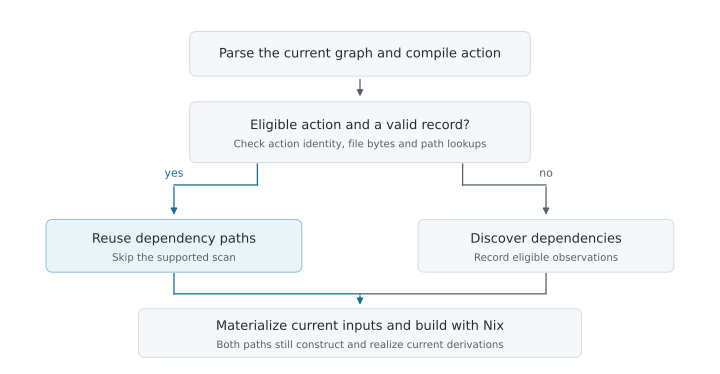
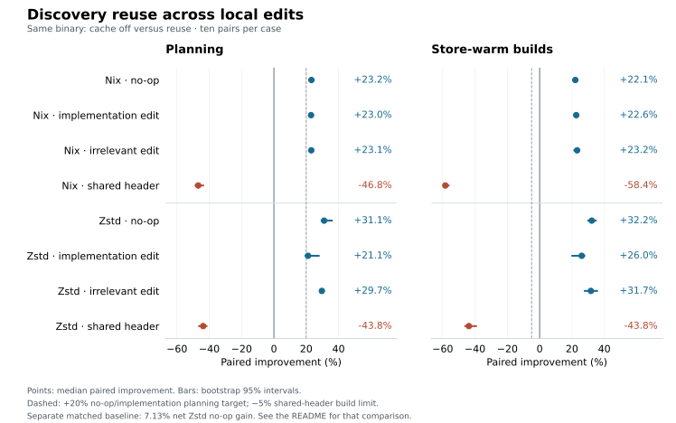

# nix-ninja-incremental

I added a local dependency-discovery cache to [PDT Partners’ nix-ninja](https://github.com/pdtpartners/nix-ninja). The goal is to avoid repeating header discovery when its result is still valid.

nix-ninja already turns Ninja build graphs into fine-grained Nix derivations. I focused on the work before those derivations are built: finding a compile action’s inputs on each local invocation. The tricky part is knowing when an old dependency list is safe to reuse.

## How it works

A hit requires the same action identity and valid filesystem observations: file contents, failed header lookups, search order, symlink resolution and file kinds. Otherwise the action scans again. Generated inputs and unsupported preprocessing also take the fresh path.



For example, a compile command searches `early/` before `late/` and finds `late/value.h`. If `early/value.h` appears later, the old header has not changed—but the compiler will now pick a different file. The cache must remember the failed earlier lookup. [That case is a regression test.](patches/0005-discovery-observations.patch#L1031)

This caches dependency paths. Graph parsing, current input uploads, derivation construction and Nix realization still run on every call. Reuse requires an exclusively owned source view for the duration of the build; it does not support a concurrently edited workspace.

## What I measured

Against the **simpler corrected baseline**, warm reuse reduces Zstd no-op planning time by **7.13%** (95% interval: **2.71–10.57%**), saving a median paired **12.46 ms**. This includes the added implementation’s overhead. It is one matched workload; the Nix baseline produces different plans, so I do not report a net Nix speedup. [Matched comparison →](https://github.com/MaruthiV/nix-ninja-incremental/actions/runs/42444066454)

The figure compares **cache off versus reuse in the same patched binary**. These larger percentages measure what enabling reuse saves after the added code is already present. They are not gains over the simpler baseline.



Shared-header edits make store-warm builds **58.37% slower on Nix** and **43.79% slower on Zstd**. Many observations invalidate, so validation and replacement recording can add work. Cold-build differences are small and their intervals include zero. I would keep this opt-in: the benefit depends on the edit pattern.

<details>
<summary>Benchmark numbers and conditions</summary>

Ten pairs per workload/scenario, native x86_64 Linux, four CPUs and 6 GiB RAM. Positive improvement means faster: median of per-pair `1 - reuse/off`, with 95% paired-bootstrap intervals (10,000 draws, seed 2027).

| Scenario | Nix improvement [95% interval] | Zstd improvement [95% interval] |
| --- | ---: | ---: |
| No-op planning | +23.23% [+21.74, +23.75] | +31.05% [+29.55, +35.87] |
| Implementation-edit planning | +22.98% [+21.99, +23.93] | +21.13% [+19.59, +27.75] |
| Shared-header store-warm build | -58.37% [-58.95, -56.34] | -43.79% [-46.02, -39.34] |
| Cold build | -0.406% [-1.556, +0.404] | -0.084% [-0.633, +0.317] |

All 180 primary pairs / 360 timed calls verify. Six of eight predeclared performance targets pass: four no-op/implementation planning targets and two cold-regression limits. Both shared-header targets fail. Store-warm measurements prewarm the declared input-state union; they do not measure first recompilation. Real-workload edits are nonsemantic content probes; semantic invalidation is tested separately with fixtures.

The full protocol is in [workloads.json](benchmarks/workloads.json). Setup, metadata initialization, resets and verification are recorded separately from timed CLI calls; the calls include validation and publication. Compiler-result caching is disabled and OS page caches are uncontrolled. CLI/waited-child RSS excludes independent daemon workers. The records do not reconstruct total controller wall time.

Raw bundles: [planning](https://github.com/MaruthiV/nix-ninja-incremental/actions/runs/42437597957), [store-warm](https://github.com/MaruthiV/nix-ninja-incremental/actions/runs/42438070314), [mapped cold pilots](https://github.com/MaruthiV/nix-ninja-incremental/actions/runs/42457149027), [remaining cold pairs](https://github.com/MaruthiV/nix-ninja-incremental/actions/runs/42463748456). Artifacts follow GitHub retention. The original dependency-download failure is retained alongside the successful same-commit Nix 5 retry; no successful measured pair was rerun.

</details>

## Checking the builds

I compare fixture builds against fresh independent Ninja builds, including artifact bytes, program results and expected compiler failures. The [256-seed campaign](https://github.com/MaruthiV/nix-ninja-incremental/actions/runs/42433715029) checks 25,344 states across `off`, `record` and `reuse`. It covers changed and missing headers, preserved timestamps, aliases, generated inputs and recovery. The [graph and lifecycle checks](https://github.com/MaruthiV/nix-ninja-incremental/actions/runs/42438687034) also exercise interrupted/corrupt state, locks and bounded retention.

The [full pinned Nix target](https://github.com/MaruthiV/nix-ninja-incremental/actions/runs/42432062401) builds and passes version, offline-evaluation and RPATH probes. That is functional validation; independent artifact-byte comparisons use the smaller fixtures. The scanner has an explicit support boundary rather than general C++ preprocessor coverage.

## Start with the code

The Rust changes are a patch stack against a pinned upstream revision. These are the useful entry points; the [series registry](patches/series.json) records application order and expected file hashes.

| Read | What to look for |
| --- | --- |
| [Reuse decision](patches/0016-validated-discovery-reuse.patch#L37) | `discovery.rs`: return validated paths on a hit, scan on a miss |
| [Observation validation](patches/0005-discovery-observations.patch#L676) | `observations.rs`: content fingerprints, absent lookups and symlink resolution |
| [Persistence](patches/0009-recorded-discovery-state.patch#L880) / [source ownership](patches/0009-recorded-discovery-state.patch#L2537) | Checked state, complete publication, locks and the input-view lease |
| [Source and query handling](patches/0015-lexical-query-discovery.patch) | Bounded lexical handling and header-presence queries |
| [Artifact oracle](tools/build_oracle.py) / [edit fixture](tests/fixtures/build_edits.json) | Fresh reference builds and deliberate stale-output fault injection |

To read the assembled source, use Git and Python 3.12+:

```sh
python3 tools/variants.py prepare recording
python3 tools/variants.py check recording
```

Then open `.work/nix-ninja-recording/crates/nix-ninja/src/discovery.rs`. This applies and verifies the pinned patches without compiling Nix.

## Run it

Full integration checks need native x86_64 Linux and Docker. Initial setup builds the pinned Nix runtime and tools; allow for that before running the demo.

<details>
<summary>Set up the isolated environment and run the artifact checks</summary>

After preparing the source above:

```sh
python3 tools/dev.py up
python3 tools/dev.py runtime
python3 tools/dev.py info
python3 tools/dev.py exec -- nix-shell --impure \
  --expr '(import /workspace/environment/baseline.nix { source = /workspace/.work/nix-ninja-recording; cliRuntime = true; }).shell' \
  --run 'python3 /workspace/tests/recording_checks.py && python3 /workspace/tests/lifecycle_checks.py'
```

For the focused ten-state graph demonstration:

```sh
python3 tools/dev.py exec -- nix-shell --impure \
  --expr '(import /workspace/environment/baseline.nix { source = /workspace/.work/nix-ninja-recording; cliRuntime = true; }).shell' \
  --run 'python3 /workspace/tools/build_oracle.py --fixture /workspace/tests/fixtures/graph_build_edits.json --discovery-mode reuse'
python3 tools/dev.py stop
```

`off` scans fresh, `record` scans and audits retained observations, and `reuse` allows validated hits. Calls emit an `NNI_DISCOVERY=` JSON audit with hits, scans and fallback reasons. Cache state is versioned, checked, locked and bounded; cache-lock contention can fall back to fresh discovery, while input-view contention is rejected.

The container has a separate project store. `stop` retains it; source/build trees live under `.work/` and raw results under `results/`. Runtime and workload identities are pinned in [pins.json](environment/pins.json). Concurrent external store collection during a call is outside the execution contract.

</details>

<details>
<summary>Verify downloaded measurements or reproduce mapped-debug collection recovery</summary>

Extract each successful artifact into its own subdirectory. Analyze contextual calibrations separately; the baseline verifier rejects different-plan comparisons.

```sh
python3 tools/baseline_summary.py results/baseline-calibration \
  --expected-binary-sha256 a9bdf2d1ba5d26a136e1b64602d9e0cc2b56232038e47ce006d3c30bc164052a \
  --output results/baseline-summary.json
python3 tools/operation_summary.py results/operation-counts \
  --output results/setup/verified-operations.json
python3 tools/evaluation_summary.py results/cold-mapped \
  --kind cold --rounds 10 --cold-control mapped-debug-paths-v1 \
  --expected-binary-sha256 a9bdf2d1ba5d26a136e1b64602d9e0cc2b56232038e47ce006d3c30bc164052a \
  --output results/cold-summary.json
```

Cold analysis needs exactly ten successful mapped pairs per workload, indices 0–9. Select the successful Nix 5 retry artifact by ID if both attempts share a name. Mapped and legacy epochs stay separate. All twenty mapped pairs pass saved artifact/object bytes, plans/probes, distinct native preflights and exact protected-store resets; complete NAR/reference/trace maps also match.

The opt-in [debug-path helper](benchmarks/cold-debug/control.nix) preserves debug information while mapping temporary task paths. The build workflow selects it with `debug_paths=mapped`. After environment setup, reproduce the [retained-trace collection check](https://github.com/MaruthiV/nix-ninja-incremental/actions/runs/42463766517):

```sh
python3 tools/dev.py exec -- nix-shell --impure \
  --expr '(import /workspace/environment/baseline.nix { source = /workspace/.work/nix-ninja-recording; cliRuntime = true; }).nixWorkload.shell' \
  --run 'python3 /workspace/tests/debug_collection_checks.py --disposable-store daemon'
```

This tiny fixture retains metadata and CA traces while collecting owned outputs, then requires a real reuse hit, identical rebuilt bytes and exact final store restoration. It is a correctness check, separate from timings. The [workflows](.github/workflows) also expose the full campaign, paired evaluations and diagnostic planner API counts; diagnostic timings are excluded from primary results.

</details>

This is an independent extension. Trace validation is established prior work, including [Build Systems à la Carte](https://www.microsoft.com/en-us/research/publication/build-systems-la-carte/). Upstream [issue #17](https://github.com/pdtpartners/nix-ninja/issues/17) already proposes retaining local dependency information, and [PR #56](https://github.com/pdtpartners/nix-ninja/pull/56) overlaps the embedded-resource work. The contribution here is the bounded integration, correctness fixes and evaluation; it has not been adopted upstream.
